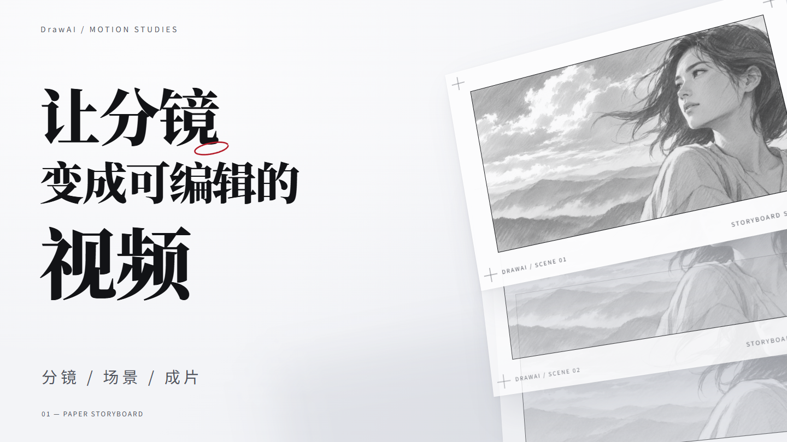
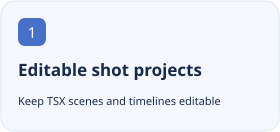
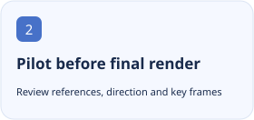
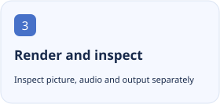

<p align="center"></p>

<h1 align="center">DrawAI Video Studio</h1>

<p align="center">Make editable code-driven videos with Remotion and React, from real references and a short pilot to rendering and quality checks.</p>

<p align="center"><a href="https://github.com/tangyixiao/drawai-video-studio"></a></p>

<p align="center"><a href="README.zh-CN.md">简体中文</a> · <a href="README.md">English</a></p>

[](https://github.com/tangyixiao/drawai-video-studio/stargazers) [](https://github.com/tangyixiao/drawai-video-studio/actions/workflows/ci.yml) [](LICENSE)



An actual preview frame from the paper storyboard pilot, not a default style for every project.

<p align="center">
  <picture><source media="(prefers-color-scheme: dark)" srcset="docs/assets/feature-1-en-dark.svg"></picture>
  <picture><source media="(prefers-color-scheme: dark)" srcset="docs/assets/feature-2-en-dark.svg"></picture>
  <picture><source media="(prefers-color-scheme: dark)" srcset="docs/assets/feature-3-en-dark.svg"></picture>
</p>

## Get started

```sh
python tools/install.py
```

The installer refuses to overwrite an existing skill. See the detailed guide for CLI and runtime setup.

Invoke `$drawai-video-studio` with real content and references, then review direction frames and a short pilot. Full rendering additionally needs FFmpeg, a browser and Remotion; run doctor first.

## Status and compatibility

| Item | Current source of truth |
| --- | --- |
| Source version | `0.1.1` · [Release](https://github.com/tangyixiao/drawai-video-studio/releases) |
| Distribution | `skill` · [Releases](https://github.com/tangyixiao/drawai-video-studio/releases) |
| Node.js | `>=20 (video CLI)` |
| Development | [Open issues](https://github.com/tangyixiao/drawai-video-studio/issues?q=is%3Aissue+is%3Aopen) · [CI](https://github.com/tangyixiao/drawai-video-studio/actions) |

This is a standalone Codex skill and does not require DSH. Distribution checks establish neither renderer readiness nor the quality of actual picture, audio and final output.

[Detailed usage, configuration and troubleshooting](docs/guide.en.md)

## Development and participation

```sh
python -m unittest discover -s tests -v
node tools/check-repository.mjs
```

[Contributing](CONTRIBUTING.md) · [Support](SUPPORT.md) · [Questions](https://github.com/tangyixiao/drawai-video-studio/discussions) · [Report a bug](https://github.com/tangyixiao/drawai-video-studio/issues/new/choose) · [Security](SECURITY.md) · [Maintenance](docs/maintenance.md)

## Star History

<picture><source media="(prefers-color-scheme: dark)" srcset="https://api.star-history.com/chart?repos=tangyixiao/drawai-video-studio&amp;type=date&amp;theme=dark&amp;legend=top-left"></picture>

[Interactive chart](https://www.star-history.com/?repos=tangyixiao%2Fdrawai-video-studio&type=date) · [GitHub Stars](https://github.com/tangyixiao/drawai-video-studio/stargazers)

The external chart uses real star records and may be cached or unavailable; no development percentage is inferred.

## Origin and licenses

[Software license](LICENSE) · [Logo artwork and attribution](skills/drawai-video-studio/assets/NOTICE.md)


Adapted from [fourzkw/dsh-drawai](https://github.com/fourzkw/dsh-drawai); upstream engine notices are retained in [NOTICE.md](NOTICE.md).
