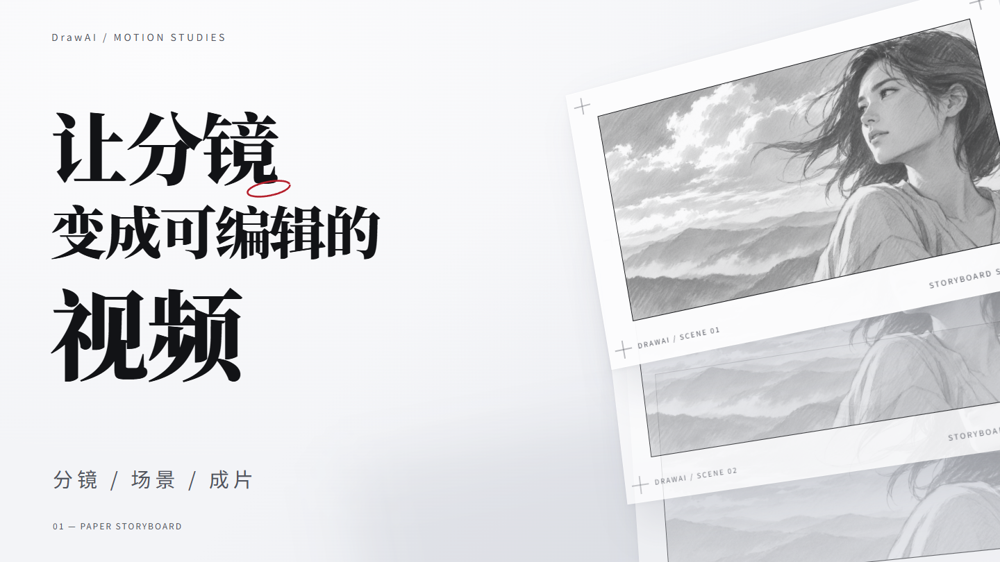
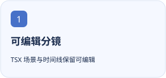
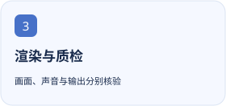

<p align="center"></p>

<h1 align="center">DrawAI Video Studio</h1>

<p align="center">用 Remotion、React 和可编辑分镜制作代码视频，从真实参考、短样片到渲染与质检。</p>

<p align="center"><a href="https://github.com/tangyixiao/drawai-video-studio"></a></p>

<p align="center"><a href="README.zh-CN.md">简体中文</a> · <a href="README.md">English</a></p>

[](https://github.com/tangyixiao/drawai-video-studio/stargazers) [](https://github.com/tangyixiao/drawai-video-studio/actions/workflows/ci.yml) [](LICENSE)



纸面分镜样片的实际预览帧；这不是所有作品的默认样式。

<p align="center">
  <picture><source media="(prefers-color-scheme: dark)" srcset="docs/assets/feature-1-zh-CN-dark.svg"></picture>
  <picture><source media="(prefers-color-scheme: dark)" srcset="docs/assets/feature-2-zh-CN-dark.svg"></picture>
  <picture><source media="(prefers-color-scheme: dark)" srcset="docs/assets/feature-3-zh-CN-dark.svg"></picture>
</p>

## 开始使用

```sh
python tools/install.py
```

安装器不会覆盖已有 Skill。CLI 与运行时准备步骤见详细指南。

安装后使用 `$drawai-video-studio`，先给真实内容和参考，再审方向帧与短样片。完整运行时需要另行准备 FFmpeg、浏览器与 Remotion；先运行 doctor。

## 当前状态与兼容性

| 项目 | 当前依据 |
| --- | --- |
| 源码版本 | `0.1.2` · [Release](https://github.com/tangyixiao/drawai-video-studio/releases) |
| 分发方式 | `skill` · [Releases](https://github.com/tangyixiao/drawai-video-studio/releases) |
| Node.js | `>=20 (video CLI)` |
| 开发状态 | [Open issues](https://github.com/tangyixiao/drawai-video-studio/issues?q=is%3Aissue+is%3Aopen) · [CI](https://github.com/tangyixiao/drawai-video-studio/actions) |

这是独立 Codex Skill，不要求安装 DSH。离线分发检查不能证明渲染环境就绪，也不能代替对实际画面、声音和最终文件的审片。

[Detailed guide](docs/guide.en.md)

## 开发与参与

```sh
python -m unittest discover -s tests -v
node tools/check-repository.mjs
```

[Contributing](CONTRIBUTING.md) · [Support](SUPPORT.md) · [Questions](https://github.com/tangyixiao/drawai-video-studio/discussions) · [Report a bug](https://github.com/tangyixiao/drawai-video-studio/issues/new/choose) · [Security](SECURITY.md) · [Maintenance](docs/maintenance.md)

## Star History

<picture><source media="(prefers-color-scheme: dark)" srcset="https://api.star-history.com/chart?repos=tangyixiao/drawai-video-studio&amp;type=date&amp;theme=dark&amp;legend=top-left"></picture>

[Interactive chart](https://www.star-history.com/?repos=tangyixiao%2Fdrawai-video-studio&type=date) · [GitHub Stars](https://github.com/tangyixiao/drawai-video-studio/stargazers)

图表由外部服务按真实星标数据生成，可能缓存或暂时不可用；未填造开发百分比。

## 来源与许可

[Software license](LICENSE) · [Logo artwork and attribution](skills/drawai-video-studio/assets/NOTICE.md)


Adapted from [fourzkw/dsh-drawai](https://github.com/fourzkw/dsh-drawai); upstream engine notices are retained in [NOTICE.md](NOTICE.md).
